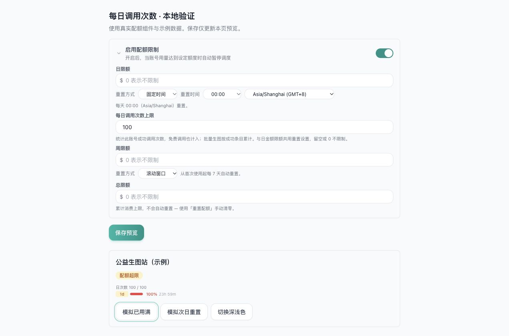
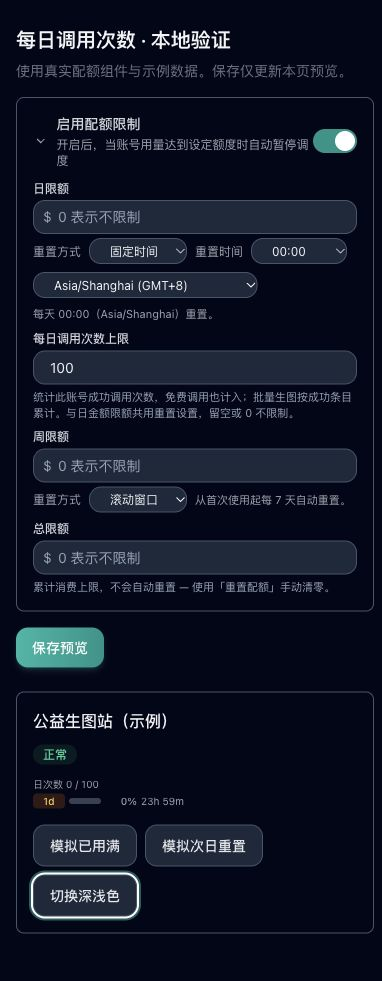

# Account daily request limit

已完成账号级每日调用次数软限额：后台可配置，免费调用计数，达到上限后
避开该账号，按已有日重置设置恢复。开发分支为
`codex/account-daily-request-quota`。所有者本次授权提交并合并至 `main`，
生产部署留待其他改动完成后统一发布。

## Goal and contract

The owner requested daily call limits for third-party upstream accounts and
explicitly accepted a soft local limit: the upstream enforces its hard quota,
and existing safe failover handles a rejected call. Do not add reservations,
shared quota pools or a new retry policy.

- API-key, Bedrock and service-account accounts can set an optional positive
  integer `quota_daily_request_limit`; absent or zero means unlimited.
- Count a successfully recorded ordinary request once, including zero-cost
  calls. Batch image settlement counts successful items, once per settlement.
- Opt-in idle keep-alive tests also count successful calls once, independently
  of customer money; ordinary scheduled/manual tests keep their existing behavior.
  See [Account idle keep-alive](ACCOUNT_IDLE_KEEPALIVE.md) for the paired feature.
- Counts are independent of money. Reuse the daily monetary quota's rolling
  24-hour or fixed-hour/timezone settings, but keep independent usage windows.
- Reaching either the monetary or request limit excludes the account from
  scheduling. The next period makes it eligible again. Preserve existing
  error/failover and ambiguous-submission protections.
- Normal edits preserve managed counters; duplication starts fresh; the
  existing explicit quota-reset operation clears both money and counts.
- This is account-wide. Use a dedicated account for an image-only upstream
  allowance. Per-model limits and sharing between account entries are out of scope.
- In-flight requests, batch work and upstream-internal retries can exceed the
  local threshold. Calls outside Sub2API are not observable. The upstream is
  authoritative; these counters are a scheduling aid, not an exact upstream meter.
- Ordinary-call counts use unified billing. Existing simple-mode and repository-less
  fallback behavior is unchanged; those paths do not meter the new account counter.

## Configuration and storage

In account creation/editing, enable the existing quota card and enter the daily
request limit, for example 100. Leave monetary limits empty if only calls matter.
The daily row's reset mode, reset hour and timezone also control the call limit.
Zero/empty disables it. Ordinary edits cannot reset usage; use the explicit quota
reset action when a manual reset is intended.

| Extra field | Meaning |
| --- | --- |
| `quota_daily_request_limit` | Integer from 0 to 2147483647; 0 means unlimited |
| `quota_daily_request_used` | Managed completed-call count in the current window |
| `quota_daily_request_start` | Managed start of the independent call-count window |
| `quota_daily_request_reset_at` | Derived next reset for fixed daily mode |

Count changes and billing claims share one transaction. Only the first settlement
applies, including zero-cost settlements. Crossing the threshold publishes the
existing scheduler outbox event. Existing cached accounts evaluate the daily
window when scheduling, so an expired exhausted snapshot becomes eligible again.
Admin writes merge fresh counters while holding the existing account row lock.

## Source reference and differences

Existing quota behavior is inherited from
[Wei-Shaw/sub2api at v0.2.19](https://github.com/Wei-Shaw/sub2api/tree/e60cefeaf78f2fbfa95aa076029e28b40d0a5527), compared with owner-fork
baseline `f03597410f48c44da86352e80e52d8c8ae2b7933` before editing.
Relevant source/test paths: `backend/internal/service/account.go`,
`account_quota_reset_test.go`, `gateway_usage_billing.go`,
`backend/internal/repository/usage_billing_repo.go`, its unit/integration tests,
and `frontend/src/components/account/QuotaLimitCard.vue`.
Keep existing license/copyright/LGPL notices. The local addition uses existing
JSON account extras, billing deduplication, transactional scheduler outbox and
admin forms; it introduces no table, monetary denomination or dependency.

## Execution and verification

All tasks are owned and written by Codex in the isolated daily-request worktree.

| Task | Depends on | Output and acceptance | Validation |
| --- | --- | --- | --- |
| T1 | — | Account extra getters, daily expiry, validation and schedulability | Below/at-limit, reset and invalid-input tests |
| T2 | T1 | Idempotent count updates in existing ordinary/batch settlement; scheduler refresh on crossing | Zero-cost, duplicate, reset and real PostgreSQL tests |
| T3 | T1, T2 | Existing account create/edit, usage and status surfaces | Form submission, count rendering, typecheck and browser inspection |
| T4 | T1–T3 | Implementation self-check and final verification record | Targeted regressions and boundary inspection |

The branch preflight was run against the latest fetched `fork/main`; its helper
reported `CANONICAL_NOT_READY` because this repository does not configure a
resolvable `.agent-worktree.toml` trunk. Work was isolated from existing dirty
checkouts with the app's managed worktree tool at the verified owner-fork ref.
Rollback disables the optional limit or uses a compatible application version;
preserve counters and billing history. No release or production action is included.

## Verification result

T1–T4 are complete. Codex performed implementation checks and local manual QA;
this record does not claim an independent code-review or release approval.

| Check | Result |
| --- | --- |
| Backend service unit suite, `go test -json -tags unit ./internal/service -count=1 -timeout=5m -parallel=4` | Passed, 258.189 s; initial default-parallel run exceeded its 180 s timeout |
| DTO and repository unit suites, `go test -tags unit ./internal/handler/dto ./internal/repository -count=1` | Passed in the broader unit run |
| Final scoped service/DTO/repository regressions | Passed: new daily limits, free billing, resets, duplication, managed bulk edits, existing failover and batch settlement |
| Real PostgreSQL/Redis integration, `go test -tags integration ./internal/repository -run '^TestDailyRequestQuota_' -count=1 -timeout=180s` | Passed with PostgreSQL 18.1 and Redis 8.4 in disposable local containers |
| Frontend quota card, create/edit forms, account usage and locale tests | 199/199 passed |
| Frontend `pnpm typecheck`, `pnpm build`, changed-file ESLint | Passed; build retains existing bundle-size/Browserslist warnings |
| Backend `go build -tags nodynamic ./cmd/server` | Passed |
| `git diff --check` | Passed |

The database scenarios verify duplicate settlement, independent money usage,
threshold outbox publication, stale admin edits, rolling/fixed reset, manual reset,
and free batch successful-item counting. Service tests also verify invalid limits,
managed fields on creation/bulk editing/duplication, and failed batch items not counting.

Local browser QA used real components and synthetic data, without an authenticated
backend or upstream calls. It verified integer input, changing 100 to 50, count-only
progress, exhausted and reset status, daily reset controls, light/dark rendering,
and 390 px layout without horizontal overflow. These fixture buttons change local
display state; real scheduling/reset behavior is verified by backend tests.

Run the fixture from `frontend/` with
`pnpm exec vite --config previews/daily-request-quota/vite.config.ts` and open
`http://127.0.0.1:5187/previews/daily-request-quota/index.html`.

Knowledge candidate: no; this is a project-specific extension of existing quotas.
