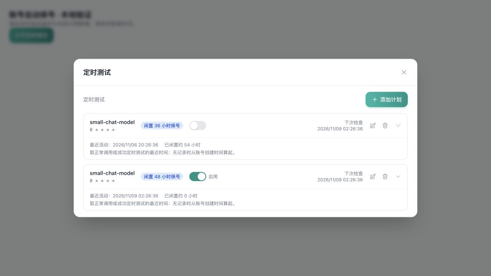
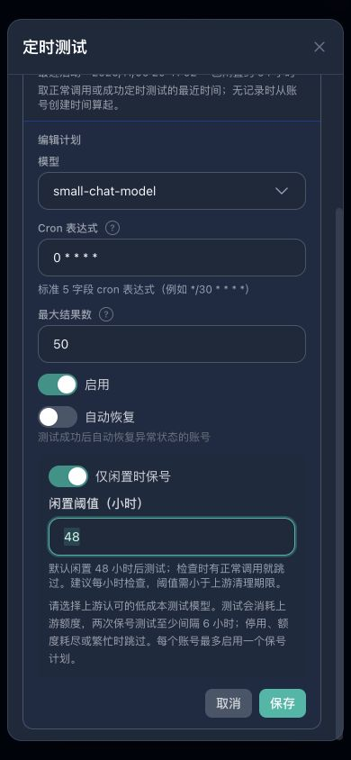
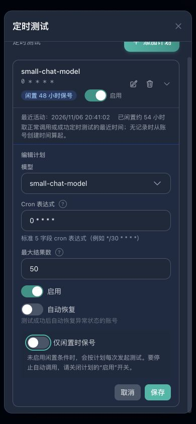

# Idle account keep-alive

已实现按账号开启的自动保号：默认闲置 48 小时后发起测试，复用现有定时
测试、模型选择和结果记录。所有者本次授权提交并合并至 `main`，生产部署留待
其他改动完成后统一发布。开发过程中未调用真实上游，也没有为任何生产账号
开启保号。

## 使用方式

后台「账号管理」→ 某账号的「定时测试」→「添加计划」，选择上游认可的
低成本模型，打开「仅闲置时保号」并保存。新建保号计划默认 48 小时、每小时
检查一次；有正常调用时跳过。阈值可改为 1–8760 的整数小时，任意两次保号
测试至少间隔 6 小时。每个账号最多启用一个保号计划。

列表展示最近活动时间、约闲置多少小时，以及下次检查时间；点击计划可查看
成功或失败记录。正常调用和成功定时测试都会重置闲置判断；没有活动记录时
从账号创建时间算起。生图批次成功结算也会记为正常活动。

停止自动调用应关闭计划的「启用」开关。「仅闲置时保号」是执行条件，关闭
这个条件会恢复普通定时测试。测试会消耗上游额度；暂停、额度耗尽或繁忙的
账号会被跳过。默认 48 小时为三天清理规则预留余量，实际保号是否生效仍取决于
上游认可哪些请求、检查频率及账号是否可用。

## Owner intent and scope

The owner requested opt-in automatic tests for public upstream accounts that may
be removed after three unused days. Extend existing per-account scheduled tests
with an idle-only mode; do not activate accounts or contact real providers during
development. Preserve the preceding daily-call quota work in the same worktree.

- `idle_hours = 0` preserves ordinary scheduled-test behavior.
- Enabling idle-only mode defaults to 48 hours, configurable through 8760 hours.
  Use a threshold below the upstream removal deadline; 72-hour cleanup cannot be
  guaranteed by waiting until hour 72 to make the first request.
- Activity is the latest ordinary account use or successful scheduled test,
  falling back to account creation. Daily counter resets are not activity.
- Reuse the selected model, account credentials, native test/transport, existing
  background-owner lease, result history and cron schedule.
- Skip accounts that are unavailable, out of quota or busy. Reserve the existing
  account concurrency slot; recheck inactivity in a durable claim before sending.
- At most one enabled idle-only plan per account. Claims precede outbound calls;
  do not immediately replay ambiguous attempts. Attempts have a six-hour cooldown.
- Successful keep-alive calls increment an enabled daily request counter once;
  they do not debit a customer's balance. The upstream may charge for the test.
- Show the last activity and current idle duration. Keep ordinary manual tests
  and their semantics unchanged. Upstream rules determine which requests count
  as activity; a successful local test cannot promise upstream retention.

## Reference and deliberate differences

Reference: Wei-Shaw/sub2api v0.2.19,
`e60cefeaf78f2fbfa95aa076029e28b40d0a5527`. Inspected source:
`backend/internal/service/scheduled_test_runner_service.go`,
`scheduled_test_service.go`, `scheduled_test_port.go`,
`backend/internal/repository/scheduled_test_repo.go`, migrations 066/070,
`frontend/src/components/admin/account/ScheduledTestsPanel.vue` and shared
account-test tests `backend/internal/service/account_test_service_openai_test.go`
and `account_test_service_openai_image_test.go`. The four unchanged CRUD/port/UI
base modules match this pinned revision. Account payload rules additionally follow
`docs/operations/ACCOUNT_TEST_INSTRUCTIONS_20261021.md` and its pinned revisions.
Keep LGPL-3.0/copyright notices. The fork adds an inactivity gate, persisted claims
and activity statistics; it does not create another provider client or job runner.

## Execution DAG

| Task | Depends on | Owner | Acceptance |
| --- | --- | --- | --- |
| K1 | — | Codex | Additive plan storage/API, validation, last-activity projection |
| K2 | K1 | Codex | Idle/quota/concurrency gates, durable claim, bounded test and idempotent success |
| K3 | K1–K2 | Codex | Existing scheduled-test create/edit controls and activity display |
| K4 | K1–K3 | Codex | Local regression/integration tests, browser QA, build and implementation self-check |

The refreshed owner-fork preflight reports `CANONICAL_NOT_READY` because the
checkout lacks a resolvable `.agent-worktree.toml` trunk. Reuse the current isolated
worktree/branch containing the owner's preceding quota request; no duplicate tree,
commit, push, release or production activation is included.

## Compatibility

Migration `276_scheduled_test_idle_keepalive.sql` adds `idle_hours` (default zero),
`last_success_at` and a partial unique index for enabled idle plans. Historical
successful scheduled results backfill the success timestamp. Result pruning does
not erase that timestamp. Completion uses the executed plan snapshot: an edit
during a probe preserves the newly configured schedule while still counting a
real successful keep-alive call once.

The migration is additive. Older application versions ignore the idle condition
and would run these plans as ordinary scheduled tests; disable idle-only plans
before such a rollback, retain data and migration columns. Local development
does not authorize production migration or background-owner changes.

## Verification result

K1–K4 are complete. Codex performed implementation self-checks and local browser
QA; this record makes no independent review or release-readiness claim.

| Check | Result |
| --- | --- |
| Full backend service unit suite, `go test -json -tags unit ./internal/service -count=1 -timeout=6m -parallel=4` | Passed in 270.366 s; 11 existing skips |
| Final focused keep-alive and native account-probe tests | Passed; real account-test code with captured fake transport, HTTP 200/403, selected model, no synthetic API-key instructions, no new retry |
| Admin handler, DTO and repository unit suites | Passed; partial enable/disable updates preserve the idle threshold; zero returns to ordinary tests; invalid/fractional thresholds are rejected |
| PostgreSQL 18.1 / Redis 8.4 integration, `CI=1 go test -v -tags integration ./internal/repository -run '^(TestScheduledKeepAlive_\|TestDailyRequestQuota_)' -count=1 -timeout=180s` | Passed in 7.206 s with disposable local containers and all migrations applied |
| Final frontend scheduled-test and locale tests | 17/17 passed, including 10 keep-alive cases |
| Full frontend suite after the baseline-test repair | 465 files / 4037 tests passed in 69.57 s; the three repaired files pass 49/49 tests |
| Frontend build (locale check + Vue/TypeScript check + Vite), changed-file/fixture ESLint | Passed; existing bundle-size/Browserslist warnings remain |
| Backend `go build -o /tmp/sub2api-keepalive-server ./cmd/server`, Wire regeneration | Passed |
| `git diff --check` | Passed |

Database coverage includes due-plan loading, ordinary/synthetic activity,
per-account uniqueness, eight concurrent claim attempts with exactly one winner,
stale edits/disabling/new business use/paused accounts, crash cooldown, changing
the next check without bypassing cooldown, idempotent success counting without
money updates, result pruning, editing during a running probe and batch activity.
Unit coverage also exercises daily exhaustion, shared concurrency, recent use,
new accounts, expiry, unavailable accounts, success/failure history and legacy
unconditional plans.

The initial five baseline frontend failures were one route-test helper that missed the
retained `/admin/orders/plans` alias, three compact-home checks selecting the
first link (now `/status`) instead of the login/dashboard button, and one sidebar
check retaining the previous product path/payment-gate expectation. Their clean-baseline
rerun reported 35 passed / 5 failed across the same three test files. The owner-authorized
follow-up repaired those tests, added nine cases, and passed both the focused and
full frontend suites, ESLint, type checking and build. The
[repair record](evidence/account-idle-keepalive/BASELINE_TEST_FAILURE_ANALYSIS.md)
contains the root causes and verification evidence. No homepage, order routing or
sidebar business-code changes are included in this repair.

Browser QA used the real `ScheduledTestsPanel` and in-memory fixture APIs:
creating the default 48-hour/hourly plan, editing to 36 hours, enabling/disabling,
activity display, viewing a result and saving from a 390 px dark form. Desktop
light/dark and mobile light/dark were inspected; the mobile document width was
390 px without horizontal overflow. The normal-mode explanation explicitly
identifies the plan's Enabled switch as the way to stop calls. These observations
verify the UI; backend tests verify the scheduler and database effects.

Reproduce from `frontend/`:

```sh
pnpm exec vite previews/account-idle-keepalive --config previews/account-idle-keepalive/vite.config.ts
```

Open `http://127.0.0.1:5188/` (append `?theme=dark` for dark mode). The fixture uses
synthetic data only and saves in memory; it does not contact an upstream.







Knowledge candidate: no; the contract belongs to this project.
